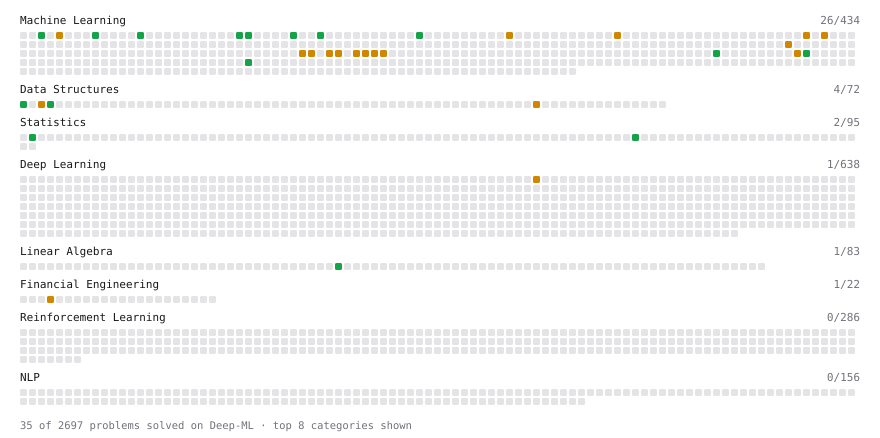

# Deep-ML

My machine learning practice from [Deep-ML](https://www.deep-ml.com). Every solution here was written by hand.

**5** solved · 3 problems · 0 labs · 2 math

[**Browse the interactive portfolio**](https://kiter-code.github.io/deep-ml/) to replay this filling in over time.

## Problems

| | Difficulty | Solved | |
| --- | --- | --- | --- |
| [Coefficient of Variation per Group with Small-Sample Correction](https://www.deep-ml.com/problems/2236) | easy | 2026-11-25 | [solution](problems/2236-coefficient-of-variation-per-group-with-small-sample-correction) |
| [Descriptive Statistics Calculator](https://www.deep-ml.com/problems/78) | easy | 2026-11-25 | [solution](problems/0078-descriptive-statistics-calculator) |
| [Automated Data Profile: Types, Missingness, Cardinality and Outliers](https://www.deep-ml.com/problems/2177) | medium | 2026-11-25 | [solution](problems/2177-automated-data-profile-types-missingness-cardinality-and-outliers) |

## Math

| | Difficulty | Solved | |
| --- | --- | --- | --- |
| [Descriptive Statistics](https://www.deep-ml.com/math-problems/18) | easy | 2026-11-25 | [solution](math/0018-descriptive-statistics) |
| [ML Workflow Basics](https://www.deep-ml.com/math-problems/30) | easy | 2026-11-26 | [solution](math/0030-ml-workflow-basics) |

---

_This file is regenerated by Deep-ML on every push._
